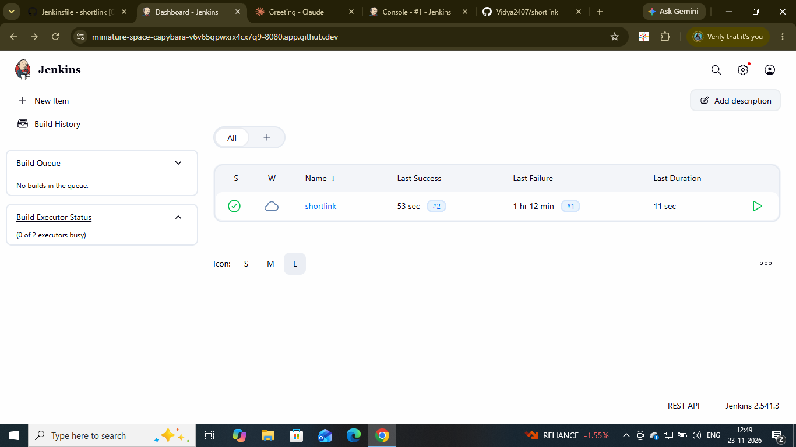
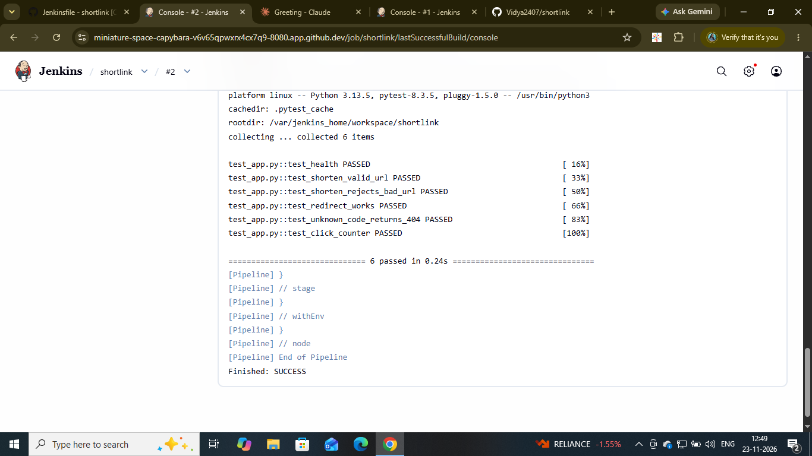
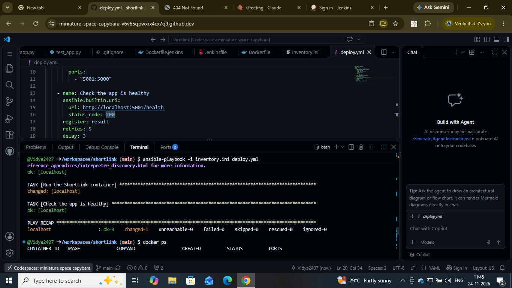
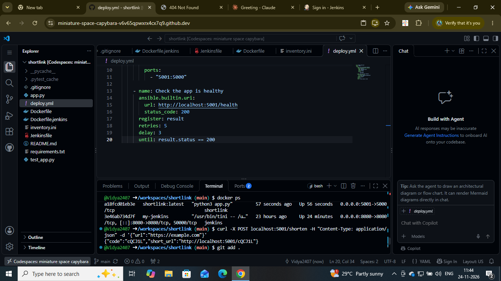

# ShortLink: URL Shortener API with Jenkins CI and Ansible Deployment

A Flask URL shortener API with automated tests, a Jenkins CI pipeline and an Ansible deployment playbook.

## What it does
- `POST /shorten` takes a long URL and returns a 6-character code
- `GET /<code>` redirects to the original URL and counts the click
- `GET /stats/<code>` shows the click count
- `GET /health` returns app status

## Tech stack
Python, Flask, SQLite, pytest, Docker, Jenkins, Ansible

## What's built
- 6 pytest tests covering valid and invalid input, redirects, 404s and the click counter
- Jenkins pipeline (Jenkinsfile) that installs dependencies and runs the tests on every build
- Dockerfile for the app image
- Ansible playbook (deploy.yml) that runs the container and verifies the /health endpoint

## Run locally
```bash
pip install -r requirements.txt
pytest -v
python app.py
```

## Deploy with Ansible
```bash
docker build -t shortlink:latest .
ansible-playbook -i inventory.ini deploy.yml
```

## Challenges
Containers in my Codespaces environment could not complete HTTPS connections to PyPI, even though the host could. I did not find the root cause, so I installed dependencies at image build time from the Debian package repository instead.

## Screenshots





## Author
Vidya Vihasini C S, [@Vidya2407](https://github.com/Vidya2407)